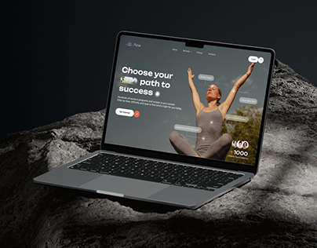

# Wellness Site Laptop on Dark Rock

**Discipline:** web · **Design type:** Device mockup scene
**Tags:** laptop, rock, dark, wellness, yoga, photography, cover

## What it is
A laptop showing a dark green wellness site with a woman in a yoga pose, resting on grey volcanic rock in a dark studio.

## What it means
Raw natural stone and a dark palette feel grounded and calm. The site's own photography echoes the theme.

## Techniques
- Rock as an organic pedestal for the device
- Dark low-key lighting with a soft highlight on the stone
- Palette matched between the site and the scene
- Angled laptop for depth
- Simple cover with no extra text

## Best for
- Wellness and yoga sites
- Website case-study covers
- Nature-inspired brands

## Vocabulary
- **Low-key lighting** — Dark overall lighting with selective highlights.
- **Organic pedestal** — A natural object used to display a product.
- **Palette echo** — Scene colours matching the design being shown.
