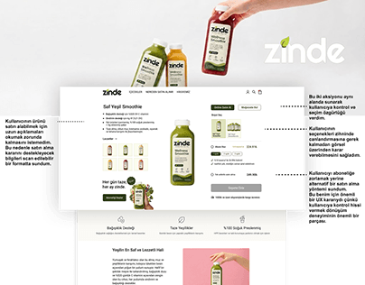

# Zinde juice e-commerce product page with UX rationale callouts pointing at add-to-cart and options

**Discipline:** web · **Design type:** UX documentation · **Design style:** Warm & Organic
**Tags:** ecommerce, juice, annotation, ux-notes, green, product-page

## What it is
A beige page for 'Zinde' cold-pressed juices: a raised hand holding three bottles above a product page (smoothie photo, subscription options, quantity and 'Add to Cart'), with three small callout notes and dotted lines pointing to the subscription choice, quantity selector and cart action, explaining each UX decision.

## What it means
Transparent and instructive; short callouts turn a finished page into a lesson on why each control exists.

## Techniques
- Annotate a real UI with short UX-rationale notes.
- Point each note to the exact element it explains.
- Keep annotations brief enough to scan in seconds.

## Best for
- UX case study callouts
- E-commerce subscription flows
- Health food brands

## Vocabulary
- **Callout annotation** — A short note pointing to a specific UI element.
- **Subscription selector** — A control for choosing one-time or recurring purchase.
