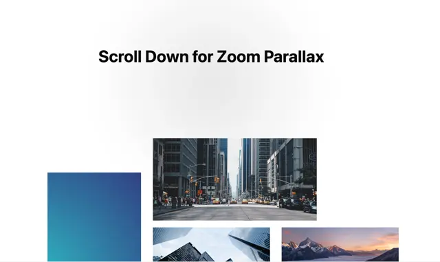

# 'Scroll Down for Zoom Parallax' heading over an arrangement of city photos and a blue gradient tile at different scales

**Discipline:** web · **Design type:** UI components
**Tags:** parallax, scroll, photo-grid, white, blue, zoom, layout, motion

## What it is
A white page with a bold black heading and a soft grey halo, and below it a loose collage of rectangles: a blue-teal gradient tile at the left, a street photo in the centre and photos of skyscrapers and a mountain sunset at the right, cut by the frame edge, showing the start of a zoom effect.

## What it means
Kinetic and layered; tiles at different sizes suggest depth once they scale on scroll.

## Techniques
- Place tiles at different sizes and offsets.
- Scale them on scroll for depth.
- Keep a plain heading above.
- Crop tiles by the frame.

## Best for
- Scroll parallax sections
- Photo showcase pages
- Motion design demos

## Vocabulary
- **Zoom parallax** — Layers scaling at different rates while scrolling.
- **Photo collage** — Photos arranged as offset rectangles.
- **Depth layers** — Elements appearing at different distances.
- **Crop by frame** — Items cut by the viewport edge.
